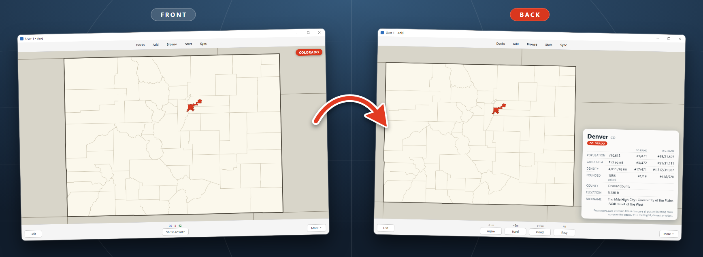
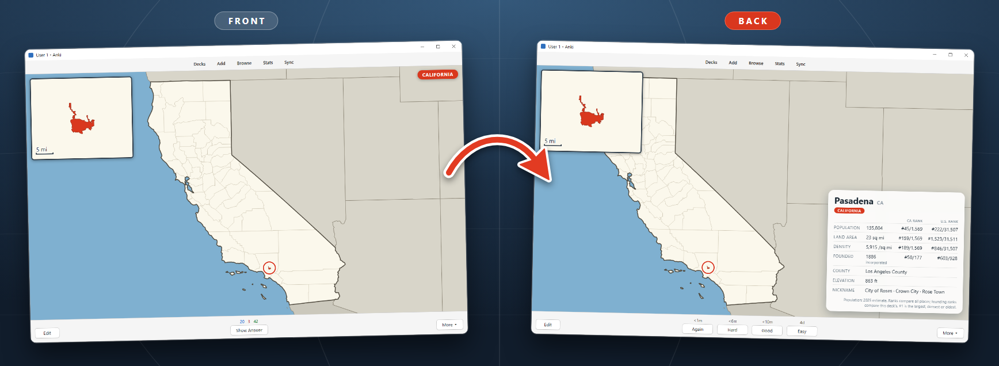

# 🏙️ Studying the US Map / Places

[](https://github.com/jackindisguise/studying-the-us-map-places/releases/latest)     [](https://github.com/jackindisguise/studying-the-us-map-places)

    

**An Anki deck for learning where U.S. cities and towns are, and a few facts about each.**
This project holds everything needed to generate the deck's data, maps and package. It is adapted from *Studying the US Map*.

---

## The deck

- **Places:** every place over 50,000 people, filled up to the 10 largest in each state. That is 1,023 notes: 895 over 50,000 and 128 smaller ones. Washington, D.C. and the territories have no notes.
- **What a place is:** the Census Bureau's word for incorporated cities, towns and villages together with census-designated places, which are communities with no city government (98 notes, such as Arlington, Virginia, and Hilo, Hawaii). Both kinds compete for the same ranks.
- **Sub-decks:** one per state, with new cards in order of population, largest first.
- **Cards:** one per note. *Locate* shows the state with one place's area in red and asks which place it is.
- **Back of the card:** name, state, population, land area, density and founding year, each with its rank in the state and the country; then county, elevation and nickname. Census-designated places are marked as such. Empty rows are hidden.
- **Maps:** one SVG per state with county lines, and one see-through SVG per place that lays its area over it in red. Places too small to see get a ring.
- **Zoom boxes:** a place that would be under 30 pixels across on a desktop card also gets a box showing it at least 3 times larger, with a scale bar, in the top-left corner or, if it would cover the place, another corner.

---

## Examples

**Locate** (Denver):



**Small place** (Pasadena), with a ring and a zoom box:



---

## How the numbers work

### Which places count

Incorporated places come from the Census Bureau's population estimates (2025). Census-designated places come from its American Community Survey (2020–2024), so their figures are a survey average and not strictly comparable; each card says which it shows. New York, New Jersey and New England towns that the Census counts only as county subdivisions are not included.

### Ranks

| Rank | Compared with |
| --- | --- |
| Population, land area, density | all places in the state, and all places in the country (including Washington, D.C.): about 31,500 |
| Founded | the places in this deck that have a year (928 nationally) |

\#1 is the largest, densest or oldest. Ties share a rank.

### Founding years

Places have no single official founding date, so each card says what its year stands for:

| Label | Cards | Meaning |
| --- | --- | --- |
| founded | 295 | the Wikipedia infobox says "Founded" |
| settled | 220 | first settlement, platting and the like |
| established | 63 | a date with no label, or Wikidata's "inception" |
| incorporated | 350 | the only date available is incorporation or a charter, often well after settlement |
| (none) | 95 | the Founded row is hidden |

Founding ranks compare these mixed kinds of date, so treat them as approximate. The rules are in `scripts/founding.js`. To correct or add a year, put it in `data/founding-fixes.json`, keyed by the place's Census GEOID, and rebuild:

```json
{ "0820000": { "year": 1858, "kind": "founded" } }
```

### County, elevation and nickname

- **County:** for incorporated places, from the Census place-by-county rows, most residents first. For census-designated places, from where the outline falls on the county map. A county holding under 5% is left out.
- **Elevation and nickname:** from the Wikipedia infobox, so some are missing. Up to three nicknames are shown, official or not. They are parsed automatically from free-form text, so check anything that looks odd.

---

## Layout

- `scripts/`: data pipeline and map renderer (run everything from the project root).
- `data/`: the state list, hand fixes, cached sources (`data/raw`) and the derived `records.json` and deck descriptions.
- `templates/locate/`: the card template for the *Place Map* note type.
- `docs/`: the AnkiWeb page (`ankiweb.md`) and the example images.
- `build/`: generated output, including `build/media/`, `build/notes.csv` and the `.apkg`.

---

## Usage

Requires Node.js 22.12 or newer.

```
npm install
npm run build
npm run apkg
```

`npm run build` writes the records, the maps and `build/notes.csv`. `npm run apkg` bundles them into `build/american-places-<version>.apkg`, ready to import into Anki. Maps are rendered on all processor cores (set `RENDER_JOBS` to use fewer).

`npm run examples` renders the images in `docs/images/` (needs Edge or Chrome). Pass IDs such as `US-PLACE-0820000` to `node scripts/build-examples.js` for test screenshots in `build/examples/`.

`npm run fetch` downloads whatever is missing from `data/raw/`; `npm run fetch:refresh` downloads everything again. The population years (`YEAR`, `ACS_YEAR`), the 50,000 cutoff (`MIN_POP`) and the per-state minimum (`TOP_PER_STATE`) are in `scripts/cities.js`.

---

## Data sources

- **U.S. Census Bureau:** 2025 population estimates, 2020–2024 American Community Survey (table B01003), and 2025 place boundaries and land areas (1:500k).
- **State and county shapes:** the `us-atlas` package. **Other countries and lakes:** Natural Earth.
- **Founding years, elevations and nicknames:** Wikipedia infoboxes (CC BY-SA) and Wikidata (CC0), matched by FIPS code.

---

## Releases

The release-please workflow is carried over from *Studying the US Map*. It does nothing until this folder is a repository on GitHub.
