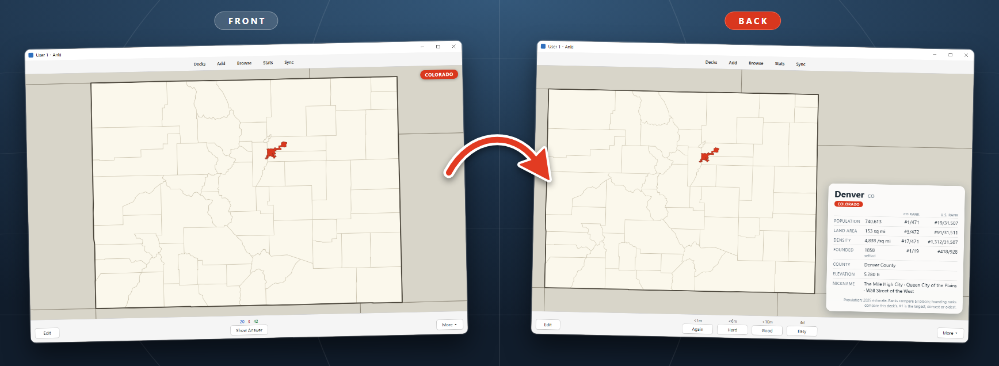
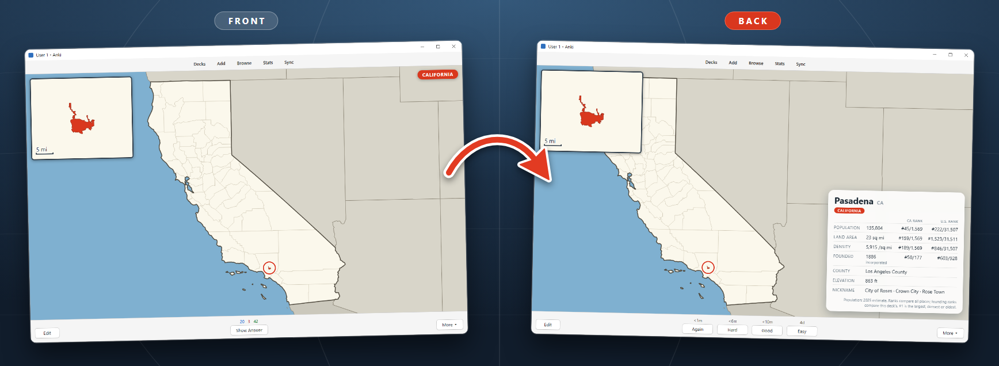

# 🏙️ Studying the US Map / Places

 <!-- x-release-please-version -->
  

    

**Learn where U.S. cities and towns are, and a few facts about each.**
Every place over 50,000 people, and at least the 10 largest in each state.

---

## Cards

Find the place shaded red on its state's map, then flip for its name and facts. Places hard to see on the state map get a ring and a zoomed-in box with a scale bar.

---

## What the back of the card shows

- **Name** and state
- **Ranked numbers**, in the state and the country: population, land area, density and founding year
- **County**, **elevation** and **nickname**

---

## Organisation

One sub-deck per state, most populous place first.

---

## Accuracy

- "Place" covers incorporated cities and towns, and census-designated places, which have no city government.
- Population is a 2025 Census estimate, or a 2020–2024 survey estimate for census-designated places.
- Each founding year is labelled *founded*, *settled*, *established* or *incorporated*. An incorporation year can be long after the first settlement, and 95 places have no year.
- Population, area and density ranks compare all places. Founding ranks compare only the places in this deck.
- Elevations and nicknames come from Wikipedia and are missing for some places.

---

## Sources

- **Population, boundaries and land area:** U.S. Census Bureau.
- **Other shapes:** us-atlas and Natural Earth.
- **Founding years, elevations and nicknames:** Wikipedia (CC BY-SA) and Wikidata.
